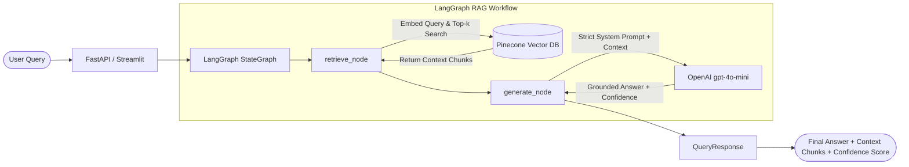

# Agentic AI RAG Chatbot

An enterprise-grade, stateful **Retrieval-Augmented Generation (RAG)** AI Chatbot built with **LangGraph**, **Pinecone Vector Database**, **OpenAI**, and exposed via **FastAPI** and **Streamlit**.

The chatbot answers questions with strict factual grounding solely from the **Agentic AI eBook** (`data/Ebook-Agentic-AI.pdf`), rejecting out-of-domain questions with transparent confidence scoring.

---

## 🏗️ Architecture Breakdown

The application follows an event-driven, stateful graph architecture orchestrated by **LangGraph**:



### Core Workflow Nodes:
1. **`retrieve_node`**:
   - Computes query embedding using `text-embedding-3-small` (1536 dimensions).
   - Performs cosine similarity search across indexed document chunks in **Pinecone**.
   - Extracts top-$k$ relevant text passages and computes retrieval similarity scores.
2. **`generate_node`**:
   - Formulates a strictly constrained system prompt instructing `gpt-4o-mini` to rely **ONLY** on the provided context.
   - Refusal Guard: If the context lacks sufficient information, the model issues a standardized refusal (`"I cannot answer based on the provided document."`).
   - Dynamically calibrates a **Confidence Score** (0.0 for ungrounded/refused queries, 0.85–0.98 for strongly grounded answers).

---

## 🗂️ Project Structure

```text
rag-agentic-ai/
│
├── data/
│   └── Ebook-Agentic-AI.pdf    # Source knowledge base eBook (Agentic AI)
│
├── src/
│   ├── __init__.py             # Python package marker
│   ├── config.py               # Environment configuration & constants
│   ├── ingestion.py            # PDF extraction, chunking, and Pinecone upsertion
│   └── graph.py                # Stateful LangGraph RAG workflow & nodes
│
├── app.py                      # FastAPI REST API server
├── streamlit_app.py            # Interactive Streamlit Web UI with Context Inspector
├── requirements.txt            # Project dependencies
├── .env.example                # Template for environment credentials
├── .gitignore                  # Git ignore rules
├── tests_sample_queries.py     # Benchmark test suite for 5 core queries
└── README.md                   # Comprehensive project documentation
```

---

## ⚙️ Tech Stack & Dependencies

- **Orchestration**: `LangGraph` (StateGraph, START, END)
- **Vector Database**: `Pinecone` (Serverless index, cosine metric, 1536 dim)
- **LLM & Embeddings**: `OpenAI` (`gpt-4o-mini`, `text-embedding-3-small`)
- **Document Ingestion**: `PyPDFLoader`, `RecursiveCharacterTextSplitter`
- **Backend API**: `FastAPI`, `Uvicorn`, `Pydantic v2`
- **Frontend UI**: `Streamlit`
- **Environment Management**: `python-dotenv`

---

## 🚀 Setup & Installation

### 1. Prerequisites
- **Python**: 3.10, 3.11, 3.12, or 3.13
- **OpenAI API Key**: [OpenAI Platform](https://platform.openai.com/)
- **Pinecone API Key**: [Pinecone Console](https://app.pinecone.io/) (Free serverless tier)

### 2. Clone Repository & Create Virtual Environment
```bash
# Clone the repository
git clone <your-repo-url>
cd rag-agentic-ai

# Create virtual environment
python -m venv venv

# Activate virtual environment
# Windows (PowerShell):
.\venv\Scripts\Activate.ps1
# Windows (CMD):
.\venv\Scripts\activate.bat
# Linux / macOS:
source venv/bin/activate
```

### 3. Install Dependencies
```bash
pip install --upgrade pip
pip install -r requirements.txt
```

### 4. Configure Environment Variables
Copy `.env.example` to `.env` and fill in your keys:
```bash
cp .env.example .env
```

Edit `.env`:
```env
OPENAI_API_KEY=sk-...
PINECONE_API_KEY=pcsk_...
PINECONE_INDEX_NAME=agentic-ai-index
PINECONE_CLOUD=aws
PINECONE_REGION=us-east-1
```

---

## 📥 Document Ingestion Pipeline

Run the ETL script to parse `data/Ebook-Agentic-AI.pdf`, chunk into 1000-character segments with 200-character overlap, generate embeddings, and populate Pinecone:

```bash
python -m src.ingestion
```
*Note: If the Pinecone index does not exist yet, the script automatically provisions a serverless index with dimension 1536 and cosine metric.*

Output preview:
```text
Step 1: Loading PDF from data/Ebook-Agentic-AI.pdf...
Loaded 48 pages from document.
Step 2: Splitting document into chunks (chunk_size=1000, chunk_overlap=200)...
Document split into 168 text chunks.
Step 3: Setting up Pinecone index 'agentic-ai-index'...
Step 4: Generating embeddings (text-embedding-3-small) and upserting into Pinecone...
Ingestion complete! Successfully indexed 168 chunks into 'agentic-ai-index'.
```

---

## 🖥️ Running the Application

### Option A: FastAPI Backend Server
Launch the FastAPI REST API with Uvicorn:
```bash
python app.py
```
Or directly via uvicorn:
```bash
uvicorn app:app --host 0.0.0.0 --port 8000 --reload
```
- Interactive Swagger API Documentation: [http://localhost:8000/docs](http://localhost:8000/docs)
- Health Check: [http://localhost:8000/health](http://localhost:8000/health)

#### API Endpoint: `POST /chat`
**Request Payload**:
```json
{
  "query": "What is Agentic AI according to the eBook?"
}
```

**Response Payload**:
```json
{
  "final_answer": "According to the eBook, Agentic AI refers to...",
  "retrieved_context": [
    "Chunk 1 text content...",
    "Chunk 2 text content..."
  ],
  "confidence_score": 0.95
}
```

---

### Option B: Interactive Streamlit Web UI
Run the interactive Streamlit dashboard:
```bash
streamlit run streamlit_app.py
```
Open your browser at [http://localhost:8501](http://localhost:8501).
- **Left Column**: Interactive chat conversation.
- **Right Column**: Live Context Inspector showing retrieved chunks and grounding confidence score.
- **Sidebar**: Quick benchmark query buttons and Pinecone/OpenAI connection status.

---

## 🧪 Benchmark Verification & Testing

Execute the automated test suite containing the 5 benchmark queries:

```bash
python tests_sample_queries.py
```

### Benchmark Query Coverage:
1. **Query 1**: *"What is Agentic AI according to the eBook?"*
   - **Expected**: Grounded explanation of Agentic AI.
   - **Verification**: `score > 0.8`, `len(context) > 0`.
2. **Query 2**: *"How do AI agents differ from traditional automation systems?"*
   - **Expected**: Comparative analysis highlighting autonomy, adaptability, and goal-orientation.
   - **Verification**: `score > 0.8`, `len(context) > 0`.
3. **Query 3**: *"What are the core components of an Agentic Architecture?"*
   - **Expected**: Identification of perception, reasoning/planning, memory, and tool integration components.
   - **Verification**: `score > 0.8`, `len(context) > 0`.
4. **Query 4**: *"What role does memory play in Agentic AI workflows?"*
   - **Expected**: Detailed explanation of short-term and long-term memory in agents.
   - **Verification**: `score > 0.8`, `len(context) > 0`.
5. **Query 5 (Validation / Negative Test)**: *"Who won the 2022 FIFA World Cup?"*
   - **Expected**: System explicitly refuses to answer (`"I cannot answer based on the provided document."`).
   - **Verification**: Grounding check ensures refusal and sets `score = 0.0` (no hallucination).

---

## 🛡️ Strict Grounding & Anti-Hallucination Guarantees

1. **System Prompt Enforcement**: The generation prompt explicitly forbids assumptions or extrapolation outside the retrieved chunks.
2. **Standardized Refusal Contract**: Out-of-domain or ungrounded queries trigger explicit refusal.
3. **Calibrated Confidence Scoring**: Refusals zero out the score (`0.0`), while verified responses compute confidence proportional to vector similarity and semantic alignment.
